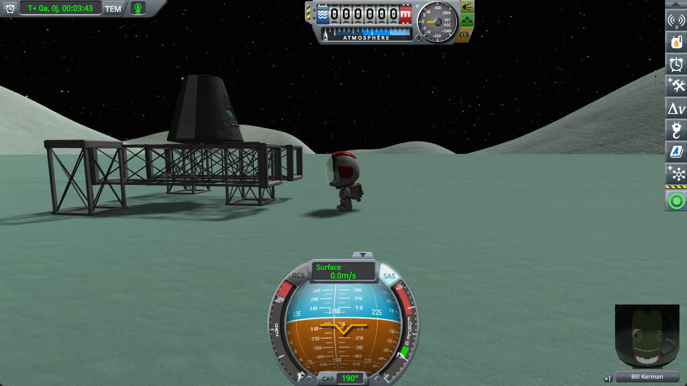
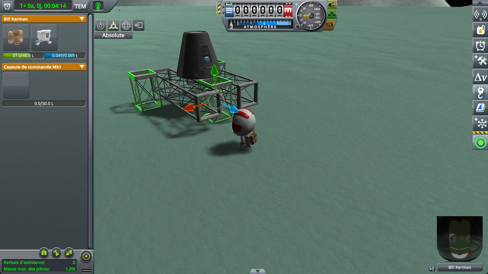
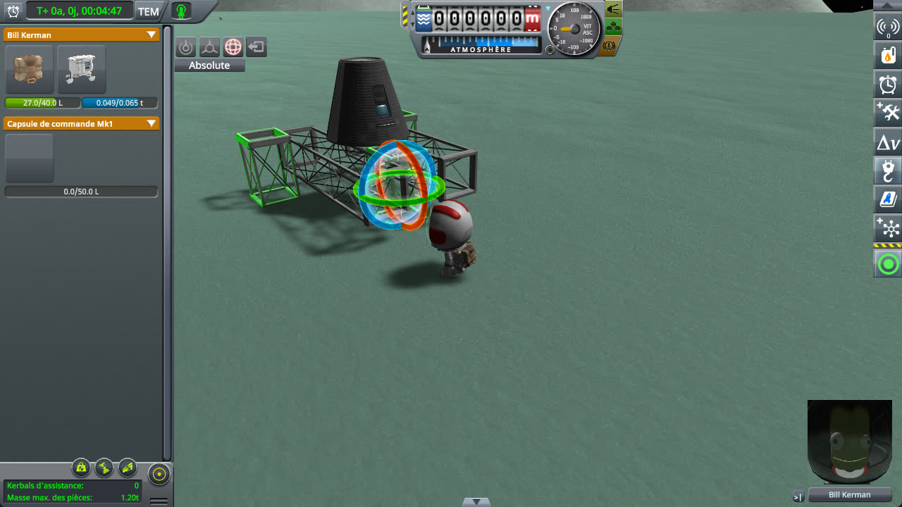
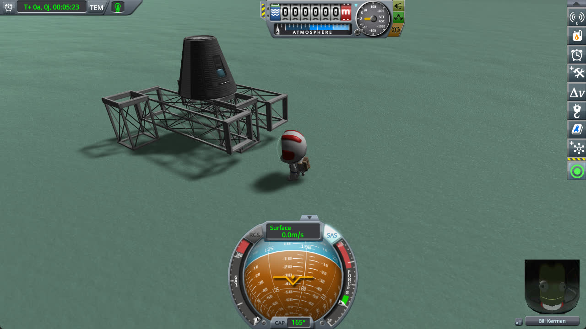
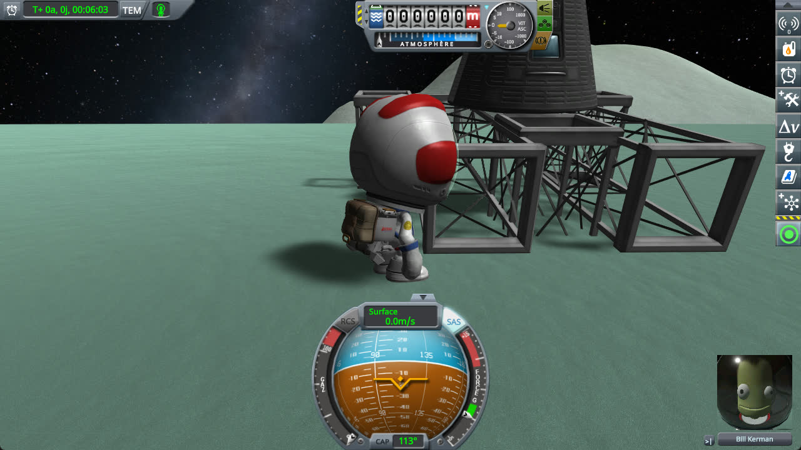

# Construction Collider Fix

**⚠️ Not finished yet.** This is a new fix, not a finished mod. The code and the conclusions on this page can still change.

A fix for stock KSP 1.12, kept as small as possible: one Harmony patch, in one source file. It is a mod of its own,
built on top of [KSP Community Fixes](https://github.com/KSPModdingLibs/KSPCommunityFixes), the base most players
run. Here is what it fixes:

> **In EVA construction mode, a part switched between the Move and Rotate tools while selected no longer collides
> with anything once released.** Its colliders stay triggers: whatever rests on it sinks through it, the ground
> included, and so does a structure standing on it, until the game is loaded again.

**How this was made.** The investigation and the code were written with Claude, Anthropic's AI
assistant. Everything here was reviewed and validated by a human — me. I am saying so up front, because
contributions made with an AI deserve a closer look than others, and because some people would rather
stop reading here. That look should be quick: the stock code involved is named and quoted on this page, every check
below is read on screenshots of the game, taken by a public script that plays its protocol and checks its outcome,
and the fix is one source file you can read in a few minutes.

## Why it matters

Placing the feet of a structure is a common gesture in EVA construction mode: an engineer turns a girder with the
Rotate tool, then, the girder still selected, picks the Move tool to bring it down onto the ground. Once the
structure is built and its weight presses on its feet, the feet pass through the ground and the structure sinks,
leans or falls. Saving and loading the game puts things back, until the next foot placed the same way.

The stand below is a Mk1 command pod on two XL girder segments, resting on three girder segments, its feet. Bill,
an engineer, stands next to it:



Bill opens the construction mode and selects the front foot with the Move tool:



The foot still selected, he picks the Rotate tool:



He closes the construction mode. Nothing has moved, the foot still stands on the ground:



The stand does not move until something unsettles it. Bill walks into its base: the foot sinks into the ground,
and only its upper part is left above it:



*KSP 1.12.5 without this mod, with [KSP Community Fixes](https://github.com/KSPModdingLibs/KSPCommunityFixes)
1.41.1, on Minmus. Between the first and the last screenshots: the construction mode opened, the front foot selected
with the Move tool, the Rotate tool picked, the construction mode closed, then the engineer walked into the base of
the stand.*

To play it yourself, copy [girder-stand.sfs](diag/girder-stand.sfs) into the folder of a sandbox game and load it:
Bill is on EVA next to the stand, on Minmus.

## The culprit

While a part is selected with the Move or Rotate tool, `EVAConstructionModeEditor` turns its colliders into
triggers, so that it can be dragged through the vessel and the ground. Before that, `FetchColliders` records each
collider with its `isTrigger` of the moment, taken as its original state, and `ToggleCollidersTrigger(false)` puts
that state back when the part is released:

```csharp
// EVAConstructionModeEditor.ToggleCollidersTrigger (KSP 1.12)
selectedPartColliders[i].collider.isTrigger = toggle | selectedPartColliders[i].isTrigger;
```

- **Each gizmo turned on records the colliders again.** `ToggleRotateGizmo(true)` and `ToggleOffsetGizmo(true)` call
  `FetchColliders`, then turn the triggers on. Turning a gizmo off only detaches it: the triggers stay.
- **Switching tools with the part selected turns a gizmo off and the other on.**
  `EVAConstructionModeEditor.OnConstructionModeChanged`, from Rotate to Move, calls `ToggleRotateGizmo(false)`, then
  `ToggleOffsetGizmo(true)`, which records the colliders *while they are triggers*. From then on, every restore
  writes `false | true`: the part is released as a trigger, and stays one.
- **Nothing else puts it back.** Releasing the part gives it back its rigidbody and its joint, not its colliders, and
  the save does not keep the state of a collider: only loading the game builds the part again.

Selecting a part, releasing it, then selecting it again with the other tool does not do it: the selection change
puts the colliders back before they are recorded.

## The fix

One patch, with its switch in [Settings](#settings), on by default. Nothing is saved; removing the mod gives the
stock behaviour back at once.

- **`releasedPartCollides`.** Before `EVAConstructionModeEditor.FetchColliders` records the colliders of the selected
  part, the mod calls `ToggleCollidersTrigger(false)`, which puts the colliders of the previous recording back as
  they were. A tool switch then records them as they really are, and the release puts them back. When the stock
  code already put them back, as it does when the selection changes, the call changes nothing.

**Why not put the colliders back when a gizmo is turned off.** `ToggleOffsetGizmo(false)` and
`ToggleRotateGizmo(false)` are also called right after a part is picked with the Place tool, whose colliders must stay
triggers while the player carries it.

**Why not record the colliders once per selection.** `FetchColliders` also records a part picked up from the
ground or detached with the Place tool: the fix before the recording covers every case where the construction mode
records colliders that are still triggers, whichever way it got there.

## Checked: a leg switched between tools

A stand rests on three legs. One leg is selected with the Rotate tool then switched to the Move tool, or the other way
round, then released; a third gesture selects a leg with the Rotate tool alone. Time then warps for a moment. On
stock, the switched leg no longer holds and the stand falls over; with this mod, it stands.

**→ Full chapter: [Checking a leg switched between tools](docs/checking-tool-switch.md)**

## Testing it automatically

[run-colliders.py](diag/automation/run-colliders.py) plays the three gestures of the protocol above through
[KSP-Util-MCPServer](https://github.com/lhervier/KSP-Util-MCPServer), and checks their outcome. Python 3 only,
nothing to install: start KSP with KSP-Util-MCPServer, copy [construction-collider.sfs](diag/construction-collider.sfs)
into a sandbox game, then run:

```
python run-colliders.py --folder <your sandbox game> --out out
```

It takes a couple of minutes, takes the screenshots the page shows, and ends with a list of checks, each printed
PASS or FAIL, then exits with 0 when all pass, 1 otherwise. The checks marked (fix) are what this mod promises: they
fail without it. The others hold on stock too.

```
PASS rotate-move the click with the Rotate tool selects the leg
PASS rotate-move (fix) once released, none of the leg's colliders is a trigger
PASS rotate-move (fix) after the warp, the pod leans less than 2 degrees
PASS move-rotate the click with the Move tool selects the leg
PASS move-rotate (fix) once released, none of the leg's colliders is a trigger
PASS move-rotate (fix) after the warp, the pod leans less than 2 degrees
PASS rotate      the click with the Rotate tool selects the leg
PASS rotate      once released, none of the leg's colliders is a trigger
PASS rotate      after the warp, the pod leans less than 2 degrees
9 of 9 checks passed
```

## Work in progress

What a player would see if this mod broke something, and how to try it by hand, with the mod and without:

- **A part carried with the Place tool.** The fix also runs when a part is detached from a vessel or picked up from
  the ground. If it broke something there, the carried part would collide with the vessel and push it while the
  player moves it. Detach a part of the stand with the Place tool, carry it through the pod, then attach it again.
- **Other mods that change EVA construction mode.** A mod that records or restores the colliders of the selected
  part itself could do it twice. With such a mod installed, play the protocol by hand.

## Install

Copy the `GameData\KSPFixConstructionCollider` folder into the `GameData` folder of KSP. It needs
[Harmony](https://github.com/KSPModdingLibs/HarmonyKSP), as KSP Community Fixes does.

## Settings

`GameData\KSPFixConstructionCollider\PluginData\settings.cfg` is read once, when KSP starts:

```
// Makes a part released in EVA construction mode collide again, even when it was switched between the Move and
// Rotate tools while selected.
releasedPartCollides = True

// How much the mod writes to KSP.log: Error, Warning, Info or Debug.
logLevel = Info
```

- With `releasedPartCollides = False`, a part switched between tools is released as a trigger, as on stock.
- At `Debug`, the mod writes one line to `KSP.log` each time it puts back the colliders of a part the construction
  mode was about to record as triggers.

## Build

Set `KSPDIR` to the folder of a KSP install with Harmony in its `GameData`, then run `build.bat`: it
compiles `GameData\KSPFixConstructionCollider\KSPFixConstructionCollider.dll`. Installing is up to you.

## License

[MIT](LICENSE).
