# Checking a leg switched between tools

Part of [Construction Collider Fix](../README.md). A small stand rests on three legs. In EVA construction mode, one
leg is selected with one tool, the other tool is picked while it is still selected, and the leg is released; then
time warps for a moment. Does the leg still hold the stand up? Played without this mod, then with it.

## The install

KSP 1.12.5 with KSP Community Fixes 1.41.1, in French, in a 1280 × 720 window, interface at 100 %, with
Construction Collider Fix 0.1.0 at `Debug` for *With this mod*.
[KSP-Util-MCPServer](https://github.com/lhervier/KSP-Util-MCPServer) is installed in both, to play the
protocol by script.

## The save

[construction-collider.sfs](../diag/construction-collider.sfs) holds the Construction Tripod on the flat grass west
of the space centre, in the morning: a Mk1 command pod standing on three small nose cones, its legs, surface-attached
under its base, their tips on the ground. Its engineer, Bill, is out on EVA five metres north of it. The legs weigh
10 kg each, light enough for one engineer to edit. The stand rests on its three legs alone: when one of them no
longer holds, it falls towards it. Copy the save into the folder of a sandbox game, and load it. The craft is
[Construction Tripod.craft](../diag/Construction%20Tripod.craft), for the VAB.

## The protocol

Three gestures, each played on a different leg, from the save loaded again:

- **Rotate, then Move.** Open the construction mode. Pick the Rotate tool, click a leg: it is selected, the
  rotation gizmo shows on it. Pick the Move tool, the leg still selected: the offset gizmo shows instead. Pick the
  Place tool: the leg is released.
- **Move, then Rotate.** The same, the Move tool first, then the Rotate tool.
- **Rotate alone**, the control. Pick the Rotate tool, click a leg, pick the Place tool. The leg is never switched
  between tools while selected.

Then, each time: close the construction mode; warp time at 5x for about two seconds (the `.` key once), back to
normal (the `,` key); let the game run five seconds, and look at the stand.

While a leg is selected, it holds nothing, and right after it is released, the stand has not moved yet: nothing
pushes it. Back from the warp on rails, the game sets the stand down under its weight again, and a leg that no
longer holds lets it fall. Select the leg only once: after a warp, the stand would lean on a leg selected again.

**Played by a script.** [run-colliders.py](../diag/automation/run-colliders.py) plays the three gestures through
KSP-Util-MCPServer. Python 3 only, nothing to install: start KSP with KSP-Util-MCPServer, copy the save into a
sandbox game, then run `python run-colliders.py --folder <your sandbox game> --out out`. It picks the tools as the
construction mode's buttons do, and clicks the leg with the mouse, as a player does, at a point where the game sees
the mouse over the leg. It ends with its checks, each printed PASS or FAIL, and exits with 1 when one fails: without
this mod, the checks marked (fix) fail.

A screenshot is taken once the save is loaded, then after the warp, from the north and from the east, the interface
hidden.

## On stock

Read off the screenshots below:

| Gesture | The stand after the warp |
|---|---|
| Rotate, then Move | **on its side, its three legs in the air** |
| Move, then Rotate | **on its side, its three legs in the air** |
| Rotate alone | standing on its three legs |

The leg switched between the Move and Rotate tools no longer holds anything, and the stand falls over it. The leg
selected with one tool only holds.

<p class="thumbs"><a href="../imgs/checking-tool-switch/stock/rotate-move/1-released-from-north.jpg">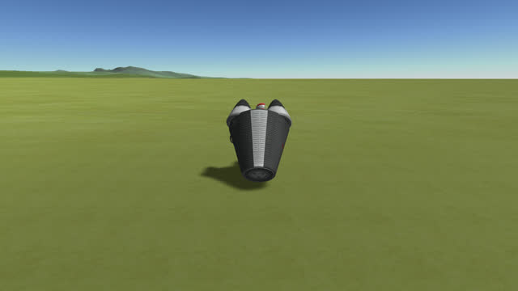</a> <a href="../imgs/checking-tool-switch/stock/rotate-move/2-released-from-east.jpg">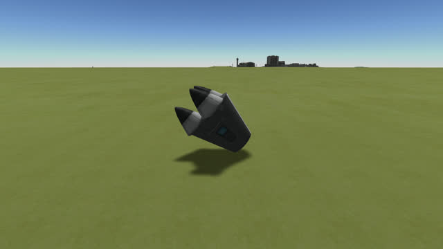</a> <a href="../imgs/checking-tool-switch/stock/move-rotate/1-released-from-north.jpg">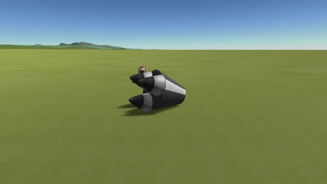</a> <a href="../imgs/checking-tool-switch/stock/move-rotate/2-released-from-east.jpg">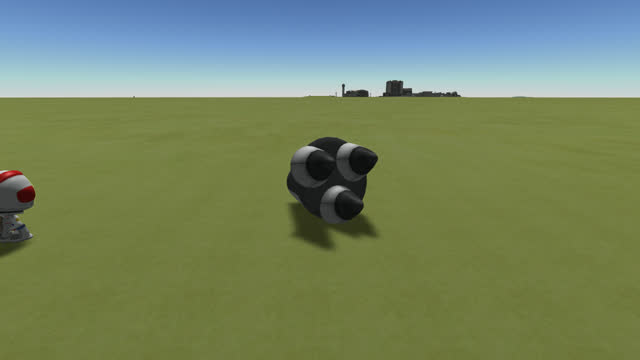</a> <a href="../imgs/checking-tool-switch/stock/rotate/1-released-from-north.jpg">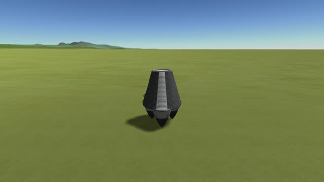</a> <a href="../imgs/checking-tool-switch/stock/rotate/2-released-from-east.jpg">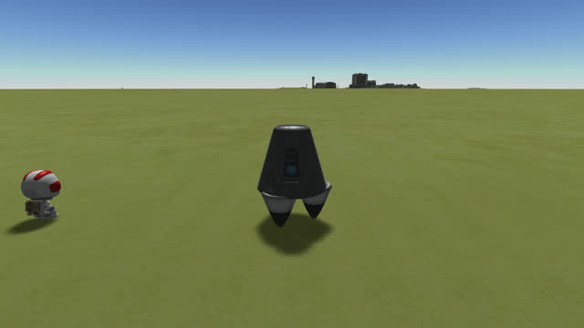</a></p>

<details>
<summary>The screenshots, on stock</summary>

The save loaded, before the first gesture:

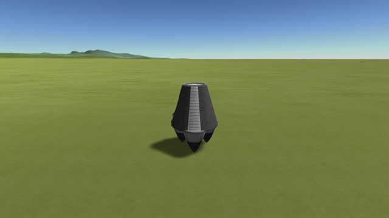

Rotate, then Move, after the warp, from the north and from the east:


Move, then Rotate, after the warp, from the north and from the east:


Rotate alone, after the warp, from the north and from the east:


</details>

## With this mod

Read off the screenshots below:

| Gesture | The stand after the warp |
|---|---|
| Rotate, then Move | **standing on its three legs** |
| Move, then Rotate | **standing on its three legs** |
| Rotate alone | standing on its three legs |

Every leg holds. The mod's log says when it put a leg's collider back, once for each switch between tools, and
not for the control:

```
[KSPFixConstructionCollider] [DEBUG] 1 collider(s) of Petite coiffe put back before the construction mode records them again
```

*Petite coiffe* is the Small Nose Cone, in French.

<p class="thumbs"><a href="../imgs/checking-tool-switch/fix/rotate-move/1-released-from-north.jpg">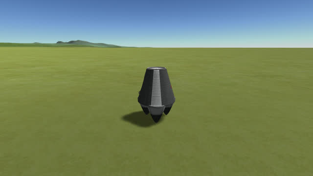</a> <a href="../imgs/checking-tool-switch/fix/rotate-move/2-released-from-east.jpg">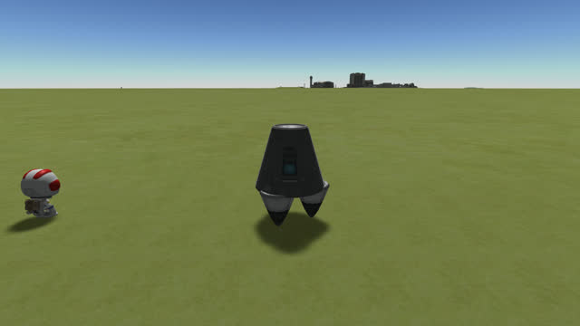</a> <a href="../imgs/checking-tool-switch/fix/move-rotate/1-released-from-north.jpg">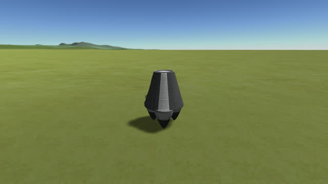</a> <a href="../imgs/checking-tool-switch/fix/move-rotate/2-released-from-east.jpg">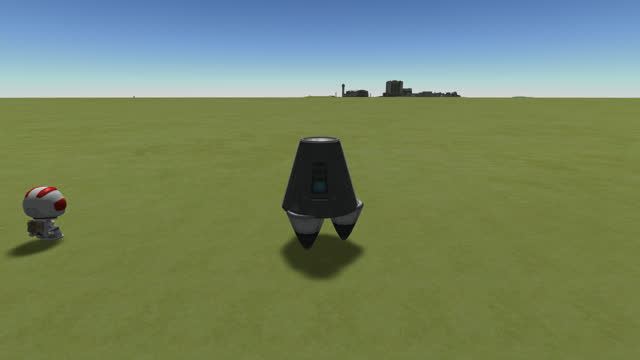</a> <a href="../imgs/checking-tool-switch/fix/rotate/1-released-from-north.jpg"></a> <a href="../imgs/checking-tool-switch/fix/rotate/2-released-from-east.jpg"></a></p>

<details>
<summary>The screenshots, with this mod</summary>

Rotate, then Move, after the warp, from the north and from the east:


Move, then Rotate, after the warp, from the north and from the east:


Rotate alone, after the warp, from the north and from the east:


</details>
